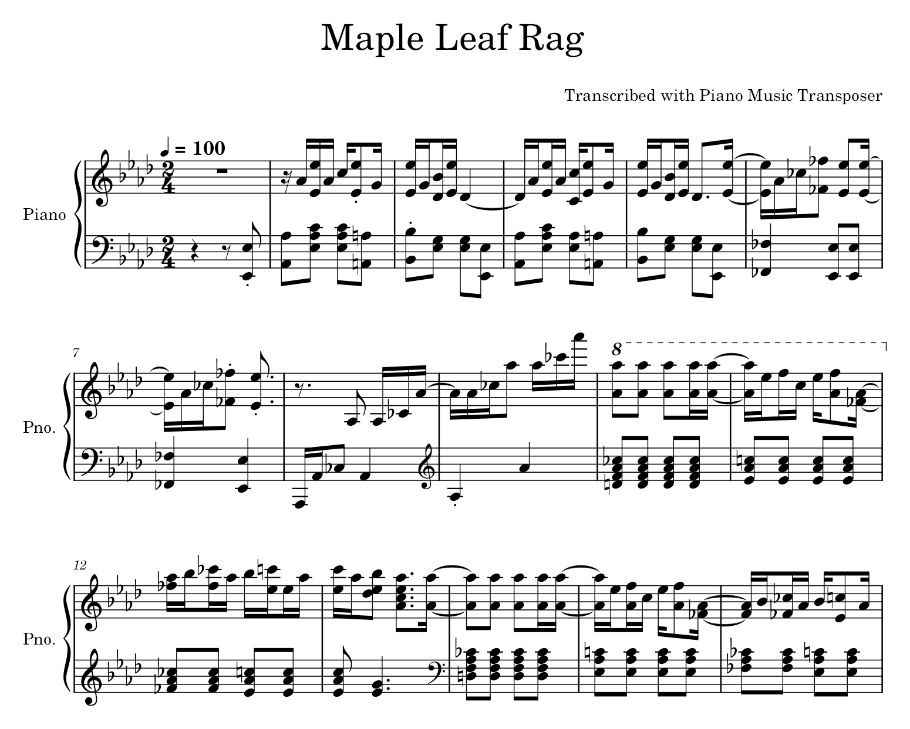
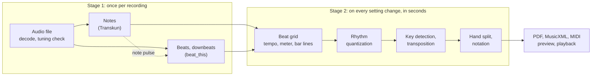

# Piano Music Transposer

Turn a solo piano recording into sheet music you can read, edit and transpose.
Upload an MP3 (or WAV, FLAC, M4A, OGG, AAC) and get both hands on a grand
staff, with rhythm, bar lines, time signature and key. Transpose it to any
key, play it back next to the original, and download it as PDF, MusicXML (for
MuseScore, Finale, Sibelius, Dorico) or MIDI.

Everything runs locally on a CPU. No audio is uploaded anywhere.


<p align="center">
  
</p>
<p align="center"><sub>
  The app's output for a synthesized recording of Joplin's <i>Maple Leaf Rag</i>
  (first 16 bars, unedited). It scores 99.9% F1 against the original score.
</sub></p>

**Built with** Python, PyTorch ([Transkun](https://github.com/Yujia-Yan/Transkun),
[beat_this](https://github.com/CPJKU/beat_this)), NumPy/SciPy, librosa,
music21, Verovio, Streamlit and MuseScore.

## Highlights

- **Audio-to-notation pipeline.** Neural piano transcription and beat
  tracking, followed by custom algorithms for tempo locking, meter
  inference, rhythm quantization, hand assignment, key detection and note
  spelling.
- **Instant re-rendering.** The audio is analysed once (about a minute for a
  5-minute piece on an 8-core CPU, no GPU needed). Changing the key, tempo,
  time signature or note filter redraws the sheet in a few seconds.
- **Every note heard is kept.** Real staccato notes can last 30 ms, so notes
  are never filtered by length, and the app reports how many of the detected
  notes made it onto the page.
- **Measured accuracy.** A benchmark renders public-domain scores to audio,
  transcribes them and checks every note against the original notation,
  including runs with random tempo changes and excerpts held out during
  development.
- **Tested.** 90 pytest tests, including regression tests for problems found
  on a real recording of Liszt's *La Campanella*.

## How it works



1. **Tuning check.** Recordings that are not tuned to A = 440 Hz (for example
   432 Hz or old tapes) are corrected first, so notes are not misread.
2. **Piano transcription.** [Transkun](https://github.com/Yujia-Yan/Transkun),
   a state-of-the-art piano transcription model, hears every note with its
   loudness, and the sustain pedal.
3. **Every note is kept.** A note is never dropped for being short or for
   being one of many in a chord. The app shows how many notes were heard and
   how many are written.
4. **Real beats.** [beat_this](https://github.com/CPJKU/beat_this) finds the
   beats and bar lines, and the transcribed notes then refine them: where the
   tracker follows a slow pulse the notes show how it divides, the tempo is
   checked against the notes' own pulse, and each beat is moved onto the note
   played on it. Notes are measured against these beats, so speeding up and
   slowing down (rubato) does not break the rhythm.
5. **Meter that survives pauses.** The bar length comes from evidence that
   does not depend on counting from the start (how far apart the bar marks
   and the accompaniment's accents are), and bar lines are re-seated after a
   fermata or a breath. 6/8, 3/4 and waltzes "in one" are told apart.
6. **Smart rhythm snapping.** Each beat is split into 8ths, 16ths, triplets...
   whichever explains the notes best while staying easy to read.
7. **Readable notation.**
   - The key is found with a method that a constantly repeated note cannot
     fool (89% correct on 4,378 pieces with a known key, against 79% for the
     classic method), and sharps and flats are spelled for it.
   - Notes are split between the hands by a beam search over what hands do:
     how far they reach, where they just were, and figures such as a melody
     note alternating with a repeated "bell" note, which one hand plays.
   - Rolled chords become one chord with an arpeggio sign, detached notes
     get a staccato dot instead of a row of rests, very high passages go
     under an 8va line, and clefs change when a hand moves high or low.

## Accuracy

`tools/benchmark.py` renders public-domain scores from the music21 corpus to
audio with MuseScore, runs the full pipeline, and compares the written notes
with the original score. A note counts only if both its pitch and its position
in the bar are right. The match allows one global shift and a half- or
double-tempo reading; meter and bar alignment are reported separately.

At a steady tempo:

| Recording | Notes detected (F1) | Pitch and beat position (F1) |
| --- | --- | --- |
| Mozart, Sonata K. 545 | 98.7% | 98.7% |
| Joplin, Maple Leaf Rag | 99.9% | 99.9% |
| C. Schumann, Polonaise op. 1/1 | 98.9% | 98.7% |
| Chopin, Mazurka op. 6/2 | 98.3% | 98.3% |
| Bach chorale BWV 66.6 | 97.3% | 97.3% |

Under harder conditions (pitch and beat position F1):

| Test | Renders | Mean |
| --- | --- | --- |
| The same five excerpts with gradual tempo changes of up to ±18% (7 random tempo curves each) | 35 | 93.3% |
| 8 excerpts held out during development, steady tempo | 8 | 89.9% |
| The same 8 excerpts with tempo changes (3 curves each) | 24 | 88.8% |

The held-out excerpts come from Bach's Prelude in C (BWV 846), C. P. E. Bach's
Sonata H. 186, Clara Schumann's Polonaises op. 1 nos. 2–4, and three later
sections of the Maple Leaf Rag. 18 of the 32 renders score 96% or higher; the
lowest scores come from the failure modes listed under
[Known limitations](#known-limitations).

`tools/hand_benchmark.py` hides the staff labels in 12 piano scores. The hand
model puts 7,587 of 8,079 notes (93.9%) back on their original staff.

### A real recording: Liszt's La Campanella

A 5-minute recording of this étude (very fast, staccato, with a "bell" note
struck over 1,200 times) is the hardest thing the app has been tested on:

| | Before | Now |
| --- | --- | --- |
| Detected notes that reach the sheet | 2,880 of 4,413 (65%) | 4,413 of 4,413 |
| Key | E♭ minor | G♯ minor (correct) |
| Time signature | 3/4 | 6/8 (correct) |
| Notes on plain eighth/sixteenth positions (first 90 s) | 44–70% | 85–97% |

There is no answer key for a live performance, so these are checks of what
the app does with the notes it hears, not a score against the printed music.
The piano model itself is steady on this recording: re-run on copies shifted
a semitone up or down, it agrees on 99% of the notes.

### Known limitations

- The benchmark recordings are synthesized. Real recordings (room sound, a
  real piano, a pianist's rubato) are harder.
- Free passages without a steady beat, such as cadenzas and long trills, are
  written out note by note.
- If the beat grid gains a beat during a fast run, everything after it is
  written one beat late in the bar. This is why C. P. E. Bach's H. 186 scores
  48% at a steady tempo, although its notes are heard correctly.
- On short excerpts the beat tracker can follow the wrong pulse (for example
  one beat per bar instead of three), which changes the written note values.
- The time signature is wrong on about a quarter of the test renders (for
  example 2/4 instead of 4/4). It can be set by hand in the sidebar.

## Setup (Windows, macOS or Linux)

You need Python 3.11 (64-bit) and FFmpeg. MuseScore 4 is optional (only for
PDF files; the in-app preview works without it).

1. Get the code:

   ```bash
   git clone https://github.com/hinley2007/piano-music-transposer.git
   cd piano-music-transposer
   ```

2. Create and activate a virtual environment.

   Windows PowerShell:

   ```powershell
   py -3.11 -m venv .venv
   .\.venv\Scripts\Activate.ps1
   python -m pip install --upgrade pip
   ```

   macOS / Linux:

   ```bash
   python3.11 -m venv .venv
   source .venv/bin/activate
   python -m pip install --upgrade pip
   ```

3. Install the Python packages (this downloads PyTorch and takes a while):

   ```bash
   python -m pip install -r requirements.txt
   ```

4. Install FFmpeg and check that `ffmpeg -version` works:
   - Windows: `winget install Gyan.FFmpeg`
   - macOS: `brew install ffmpeg`
   - Ubuntu/Debian: `sudo apt install ffmpeg`

5. Optional: install [MuseScore 4](https://musescore.org/) for PDF export. If
   it is not found automatically, set `MUSESCORE_PATH` to its executable, for
   example `$env:MUSESCORE_PATH = "C:\Program Files\MuseScore 4\bin\MuseScore4.exe"`.

The first transcription downloads the beat tracker (about 80 MB)
automatically. The piano model comes with its package.

## Run the app

```bash
python -m streamlit run app.py
```

Then open the address it prints (normally http://localhost:8501).

1. Upload a piano recording.
2. Optional: open **Transcribe only part of the recording** to pick a section
   of a long file.
3. Press **Transcribe**. On a modern 8-core CPU a 5-minute piece takes about a
   minute (no GPU needed).
4. Review the sheet music, and play **Sheet music, played back** next to the
   original recording to compare them.
5. Adjust the sheet in the sidebar. Changes take a few seconds, because the
   audio is not processed again:
   - **Transpose**: pick a new key. The number next to each key is how many
     semitones the music moves up (+) or down (−).
   - **Notes to write**: "Balanced" writes every note except the very
     faintest, "Detailed" writes all of them, "Clean" leaves out quiet ones.
     The line under the figures says how many of the notes heard are written.
   - **Time signature** and **Tempo**: found automatically. If notes look
     twice as long or short as expected, halve or double the tempo; if the bar
     lines look shifted, pick the time signature yourself.
   - **Simpler rhythm** (no triplets or 32nd notes) and **Title**.
6. Download the **PDF**, **MusicXML** or **MIDI**. The PDF is engraved by
   MuseScore when you click, which takes a few seconds.

### Tips for the best results

- Solo piano recorded close and clean works best. Room echo, applause or
  other instruments cause mistakes.
- For long recordings, transcribe one section at a time.
- The MusicXML download opens in MuseScore (free), where any remaining small
  mistakes take seconds to fix.

## Command line

The whole pipeline also runs without the app, which is handy for batches:

```bash
python pipeline.py recording.mp3 --out output --pdf
```

Other options: `--title "La Campanella"`, `--time-signature 6/8`,
`--transpose 2`, `--start 30 --end 90` (seconds),
`--notes "Detailed (more notes)"`.

## Tests and benchmarks

```bash
python -m pytest -q                           # 90 tests, a few seconds
python tools/benchmark.py                     # needs MuseScore 4
python tools/benchmark.py --rubato --seed 3   # with a random tempo curve
python tools/hand_benchmark.py                # which staff each note belongs on
```

## Project structure

- `app.py`: the Streamlit app (upload, transcribe, sheet settings in the
  sidebar, preview, playback, downloads).
- `pipeline.py`: runs everything; stage 1 analyses the audio (slow), stage 2
  writes the notation (fast). Also the command-line tool.
- `audio_utils.py`: upload checks, FFmpeg decoding, tuning detection.
- `transcription.py`: piano note detection (Transkun).
- `beat_tracking.py`: beats, steady-tempo correction using the notes, meter
  scoring.
- `performance.py`: rolled (arpeggiated) chords.
- `rhythm.py`: beat grid, locking beats to notes, rhythm snapping, meter and
  bar-line choices.
- `keys.py`: key detection and key-aware note spelling.
- `notation.py`: hand splitting, chords, rests, ties, clefs, 8va lines;
  builds the score.
- `exporters.py`: MusicXML, MIDI, PDF (MuseScore) and the preview (Verovio).
- `synth.py`: a small synthesizer for "Sheet music, played back".
- `music_types.py`, `config.py`: shared data types and settings.
- `tests/`: unit and regression tests. `tools/`: accuracy benchmarks.
- From earlier versions, not used by the app:
  - The song, single-melody and other-instrument modes: `separation.py`,
    `chords.py`, the melody/general parts of `transcription.py`, and
    `tools/song_benchmark.py`. The command line still accepts
    `--mode song|melody|other`.
  - `music_processing.py` and `tests/test_music_processing.py`: the first
    pipeline, built on Basic Pitch.

## Troubleshooting

**"FFmpeg was not found":** install FFmpeg, restart the terminal, and check
`ffmpeg -version`.

**No PDF button:** install MuseScore 4 or set `MUSESCORE_PATH`, then restart
the app. MusicXML and MIDI downloads always work.

**Notes look twice as fast or slow:** set **Tempo** to half or double.

**Bar lines feel shifted, or the meter is wrong:** choose the time signature
yourself.

**Notes seem to be missing:** check the line "N of M notes heard are
written". If N is lower, set **Notes to write** to "Detailed". If a note is
missing from M too, the model did not hear it (very soft notes inside loud
chords are the usual case).

**A fast, free passage (cadenza, long trill) looks like a wall of notes:** it
has no steady beat to measure against. Try **Simpler rhythm**, or tidy that
bar in MuseScore.

**First run is slow:** the models are downloaded and loaded once; later runs
are faster.

## Acknowledgements

- [Transkun](https://github.com/Yujia-Yan/Transkun) for piano transcription.
- [beat_this](https://github.com/CPJKU/beat_this) for beat and downbeat
  tracking.
- [music21](https://github.com/cuthbertLab/music21) for the score model, and
  its corpus for the benchmark pieces.
- [Verovio](https://www.verovio.org/) for the in-app preview, and
  [MuseScore](https://musescore.org/) for PDFs and benchmark audio.
- [librosa](https://librosa.org/) and [Streamlit](https://streamlit.io/).

## License

MIT, see [LICENSE](LICENSE). The models and libraries above have their own
licenses.
